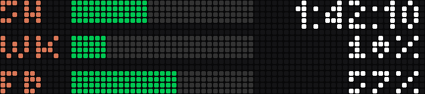
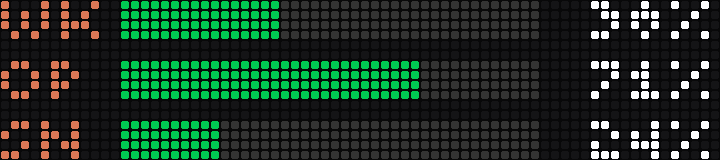

# busybar-cclimits

Claude Code's usage limits on a [BUSY Bar](https://busy.bar): a bar for the
5-hour window with a live countdown to its reset, and one for the week.


The top row is the 5-hour window, with the time to its reset; the bottom row
is the week, with the percentage used. Bars are green, yellow from 75% and
red from 90%. The countdown ticks on
the bar itself; once a window resets the bar empties and the time reads `--`
until Claude Code starts a new one.

## Where the numbers come from

By default (`[source] kind = "api"`) the service asks Anthropic's usage
endpoint every two minutes: the one behind Claude Code's own `/usage`,
called with the sign-in Claude Code already has. It reports

- `five_hour` and `seven_day`: the 5-hour and weekly windows;
- a model's own weekly limit, such as `seven_day_fable` for Fable (and
  `seven_day_opus`, `seven_day_sonnet` where a plan has them);
- `extra_usage`: the month's usage credits, as a share of their limit.

`busybar-cclimits usage` asks once and lists what your account reports; any
of those names can be a row.

The sign-in is read from the macOS Keychain item "Claude Code-credentials"
(or `~/.claude/.credentials.json`) and never changed: when its access token
expires, the service waits until Claude Code renews it rather than refreshing
it itself, which would sign Claude Code out. The token goes only into that
request's Authorization header. The endpoint is not documented, so a Claude
Code release could change it; `usage --json` shows the answer as it comes.

The other source, `kind = "statusline"`, reads no credentials and calls
nothing: Claude Code hands its
[status line](https://code.claude.com/docs/en/statusline) command the 5-hour
and weekly windows (for Pro and Max, after a session's first response), and
`busybar-cclimits hook install` wraps your status line command so that
`busybar-cclimits statusline` stores them before running yours. It has no
per-model limits and no usage credits, and is only as fresh as Claude Code's
last response.

## Set up

```sh
uv tool install git+https://github.com/kurok/busybar-cclimits

busybar-cclimits init --cloud --keychain busybar    # or: init --host 10.0.4.20 (USB) / the bar's LAN IP
busybar-cclimits usage             # what Anthropic reports for your account
busybar-cclimits test              # sample limits on the bar for 20 seconds
busybar-cclimits install --auto-update              # run in the background from now on
busybar-cclimits status            # the limits, the source and the service
```

To add Fable as a third row, put this in `~/.config/busybar-cclimits/config.toml`:

```toml
[[display.rows]]
window = "five_hour"

[[display.rows]]
window = "seven_day"
text = "percent"

[[display.rows]]
window = "seven_day_fable"
text = "percent"
```

`--cloud` reaches the bar through BUSY Cloud with a token that has the
"BUSY Bar" access scope; keep it in the macOS Keychain:

```sh
security add-generic-password -s busybar -a "$USER" -w    # paste the token at the prompt
```

On the LAN or over USB, give `--host`; a token is only needed if the bar's
Wi-Fi API has a password (`--keychain` or `--token-env VAR`).

`install` runs the service as a launchd agent on macOS (log:
`~/Library/Logs/busybar-cclimits.log`) or a systemd user unit on Linux. With
`--auto-update` each start first runs `uv tool upgrade busybar-cclimits`, so
`busybar-cclimits restart` moves it to the latest version.

## Sharing the bar

Drawings go in at priority 50: above the bar's own apps (10), below a
running BUSY session (90) and the calendar reminders of
[busybar-calendar](https://github.com/kurok/busybar-calendar) (91). The bar
does not bring a drawing back after something else covered it, so the
service sends it again every minute (`refresh_seconds`); while something
higher holds the screen the bar refuses with a 409, which only means wait.
Every element carries `display_until`, so if the service stops the bar
takes the drawing down by itself within three minutes.

To have the bar show the limits only while you work with Claude Code, set
`show = "with_claude"`: the limits stay up while the numbers have moved in
the last 15 minutes (or, with the status line source, while it has run), or
while a window is at 80% or more.

## Screens

| | |
| --- | --- |
|  | Past 75%: yellow |
|  | Past 90%: red |
|  | The 5-hour window has reset |
|  | `text = "time"` on the week too |
|  | One row |
|  | `text = "none"`: bars only |
|  | Three rows: a `seven_day_fable` row under the week |
|  | The week, Opus and Sonnet |

These are captures from a real bar (firmware 1.2.4): `busybar-cclimits
snapshot` draws each sample and saves what the display then shows.
`scripts/render_previews.py` draws the same samples without a bar, in the
firmware's fonts; its pictures match the bar's LED for LED except for the
seconds of a ticking countdown, and `preview.gif` comes from it.

## Configuration

Every setting has a default; [config.example.toml](config.example.toml)
lists them all. Among them: where the limits come from (`[source]`), which
windows the rows show - up to three, of `five_hour`, `seven_day`,
`extra_usage`, `spend_limit` and per-model windows such as `seven_day_fable`
- what is printed beside each bar
(`time`, `percent` or `none`), the thresholds and every colour.

## Commands

| Command | |
| --- | --- |
| `busybar-cclimits` | where you stand, or the first steps |
| `usage [--json]` | ask Anthropic's usage endpoint once and list the limits your account reports |
| `init --cloud` / `init --host ADDR` | write the config |
| `status [--json]` | the limits, the source and the service |
| `statusline [--then CMD]` | for `kind = "statusline"`: the status line command, which stores the limits, then runs `CMD` or prints `5h 42% (1h17) · week 18% (3d4h)` |
| `hook install` / `hook uninstall` | for `kind = "statusline"`: put it in Claude Code's settings, or take it out and restore your own (`--dry-run` shows the change) |
| `test`, `demo` | sample limits on the bar |
| `snapshot [SAMPLE...]` | draw sample states and save what the bar shows, as 72x16 PNGs |
| `run [--auto-update]` | the service, in the foreground |
| `install`, `restart`, `uninstall` | the background service |

## As a BUSY Bar gallery app

The repository is also an app folder for the
[community gallery](https://github.com/maxswinkels/busybar-apps):
`python app.py` runs the same service against a bar over USB
(`--host 127.0.0.1:8080` for the emulator), `python app.py --hook` sets up the
status line, and without limits yet it plays a demo.

## Remove

```sh
busybar-cclimits uninstall
busybar-cclimits hook uninstall
uv tool uninstall busybar-cclimits
```

## Development

```sh
uv sync
uv run pytest -m "not emulator"
uv run ruff check . && uv run ruff format --check .
```

`tests/emulator` runs the app against the
[BUSY Bar emulator](https://github.com/maxswinkels/busybar-emulator), which
enforces the firmware's draw contract: element ids, colours, priorities and
409s, merge-by-id and the 100-element cap. Point `BUSYBAR_EMULATOR` at a
checkout (no `npm install` needed, only `node`):

```sh
BUSYBAR_EMULATOR=~/src/busybar-emulator uv run pytest tests/emulator
```

MIT licensed. Not affiliated with Anthropic or Flipper Devices.
