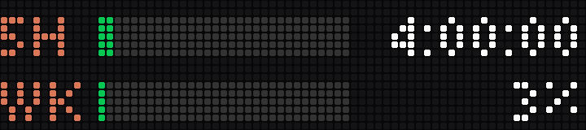
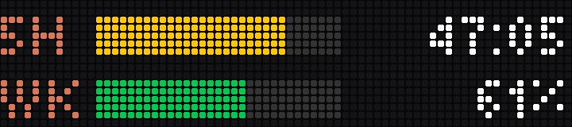
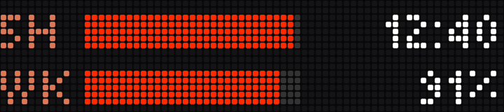
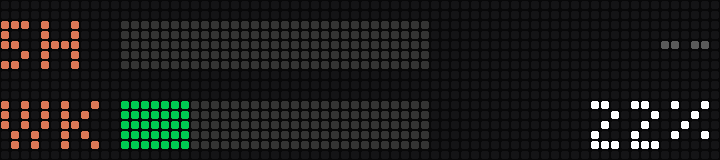
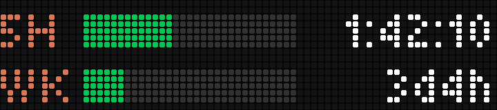
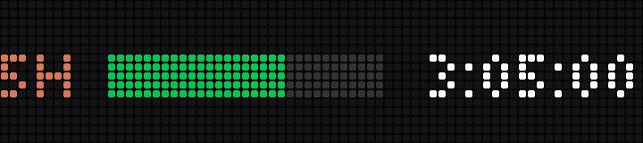
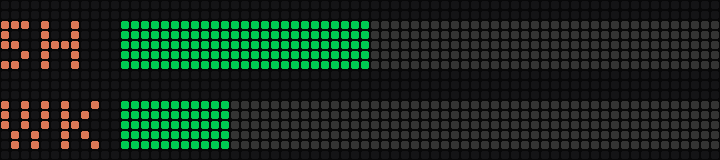

# busybar-cclimits

Claude Code's usage limits on a [BUSY Bar](https://busy.bar): a bar for the
5-hour window with a live countdown to its reset, and one for the week.



The top row is the 5-hour window, with the time to its reset; the bottom row
is the week, with the percentage used. Bars are green, yellow from 75% and
red from 90%. The countdown ticks on
the bar itself; once a window resets the bar empties and the time reads `--`
until Claude Code starts a new one.

## Where the numbers come from

Claude Code hands its [status line](https://code.claude.com/docs/en/statusline)
command a JSON object on every update, and for claude.ai subscriptions that
object carries `rate_limits`: the 5-hour and 7-day windows, each with the
percentage used and the reset time (and behind a Claude apps gateway, your
spend limit). `busybar-cclimits statusline` stores those numbers in
`~/.cache/busybar-cclimits/limits.json` and then runs the status line command
you already had, so your status line looks the same. The service watches the
file and draws.

So nothing reads your Claude credentials and nothing calls an Anthropic API:
the numbers are the ones Claude Code itself shows. Two consequences:

- They are as fresh as Claude Code's last response. Use on claude.ai or the
  desktop app counts towards the same limits, but shows here only after your
  next Claude Code request.
- They arrive after a session's first response. Claude Code documents them
  for Pro and Max subscribers; `busybar-cclimits status` tells you whether
  your plan sends them.

## Set up

```sh
uv tool install git+https://github.com/kurok/busybar-cclimits

busybar-cclimits hook install      # wraps the status line in ~/.claude/settings.json (backed up)
busybar-cclimits init --cloud --keychain busybar    # or: init --host 10.0.4.20 (USB) / the bar's LAN IP
busybar-cclimits test              # sample limits on the bar for 20 seconds
busybar-cclimits install --auto-update              # run in the background from now on
busybar-cclimits status            # the limits, the hook and the service
```

`--cloud` reaches the bar through BUSY Cloud with a token that has the
"BUSY Bar" access scope; keep it in the macOS Keychain:

```sh
security add-generic-password -s busybar -a "$USER" -w    # paste the token at the prompt
```

On the LAN or over USB, give `--host`; a token is only needed if the bar's
Wi-Fi API has a password (`--keychain` or `--token-env VAR`).

`install` runs the service as a launchd agent on macOS (log:
`~/Library/Logs/busybar-cclimits.log`) or a systemd user unit on Linux. With
`--auto-update` each start first runs `uv tool upgrade busybar-cclimits`, so
`busybar-cclimits restart` moves it to the latest version.

## Sharing the bar

Drawings go in at priority 50: above the bar's own apps (10), below a
running BUSY session (90) and the calendar reminders of
[busybar-calendar](https://github.com/kurok/busybar-calendar) (91). The bar
does not bring a drawing back after something else covered it, so the
service sends it again every minute (`refresh_seconds`); while something
higher holds the screen the bar refuses with a 409, which only means wait.
Every element carries `display_until`, so if the service stops the bar
takes the drawing down by itself within three minutes.

To have the bar show the limits only while you work with Claude Code, set
`show = "with_claude"`: the limits stay up while Claude Code has updated them
in the last 15 minutes, or while a window is at 80% or more.

## Screens

| | |
| --- | --- |
|  | Past 75%: yellow |
|  | Past 90%: red |
|  | The 5-hour window has reset |
|  | `text = "time"` on the week too |
|  | One row |
|  | `text = "none"`: bars only |

`scripts/render_previews.py` draws these from the app's own layout code in
the firmware's fonts; `busybar-cclimits snapshot` draws each sample on a real
bar and saves what its display then shows.

## Configuration

Every setting has a default; [config.example.toml](config.example.toml)
lists them all. Among them: which windows the two rows show
(`five_hour`, `seven_day`, `spend_limit`), what is printed beside each bar
(`time`, `percent` or `none`), the thresholds and every colour.

## Commands

| Command | |
| --- | --- |
| `busybar-cclimits` | where you stand, or the first steps |
| `statusline [--then CMD]` | the status line command: store the limits, then run `CMD` or print `5h 42% (1h17) · week 18% (3d4h)` |
| `hook install` / `hook uninstall` | put it in Claude Code's settings, or take it out and restore your own (`--dry-run` shows the change) |
| `init --cloud` / `init --host ADDR` | write the config |
| `status [--json]` | the limits, the hook and the service |
| `test`, `demo` | sample limits on the bar |
| `snapshot [SAMPLE...]` | draw sample states and save what the bar shows, as 72x16 PNGs |
| `run [--auto-update]` | the service, in the foreground |
| `install`, `restart`, `uninstall` | the background service |

## As a BUSY Bar gallery app

The repository is also an app folder for the
[community gallery](https://github.com/maxswinkels/busybar-apps):
`python app.py` runs the same service against a bar over USB
(`--host 127.0.0.1:8080` for the emulator), `python app.py --hook` sets up the
status line, and without limits yet it plays a demo.

## Remove

```sh
busybar-cclimits uninstall
busybar-cclimits hook uninstall
uv tool uninstall busybar-cclimits
```

## Development

```sh
uv sync
uv run pytest
uv run ruff check . && uv run ruff format --check .
```

MIT licensed. Not affiliated with Anthropic or Flipper Devices.
